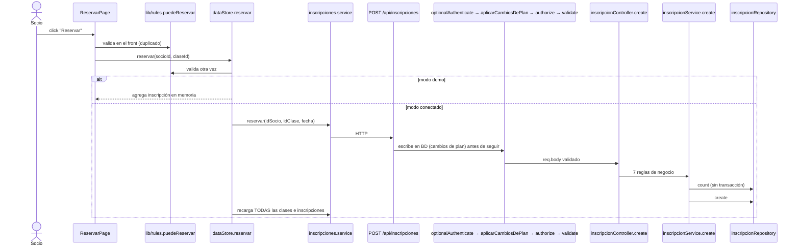
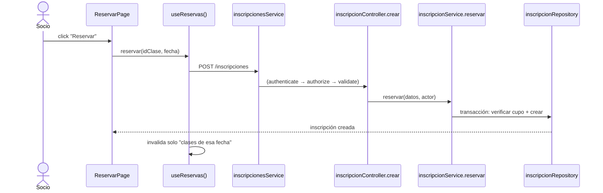

# Auditoría técnica: Hades Gym Manager

**Fecha:** 16/11/2026
**Alcance:** backend, frontend y la integración entre los dos, contra los requisitos de la cátedra ([README](../README.md), [docs.md](../docs.md), [FAQ](../FAQ.md)) y lo comprometido en la [proposal](../proposal.md).
**Criterios:** *Clean Code* (R. C. Martin) y *The Pragmatic Programmer* (Hunt y Thomas). Cada hallazgo cita el principio que incumple.

| Repositorio | Commit auditado | Rama |
|:-|:-|:-|
| [DSW-Backend](https://github.com/Vuadens/DSW-Backend) | `702bc2b` (PR #25) | `origin/main` |
| [DSW-Frontend](https://github.com/Vuadens/DSW-Frontend) | `e3f9818` (PR #14) | `origin/main` |

> **Fuente de los requisitos.** `README.md`, `docs.md` y `FAQ.md` de este repo son idénticos a los del repositorio original de la cátedra ([utnfrrodsw/tp](https://github.com/utnfrrodsw/tp)). La única diferencia son las líneas `tags`/`Status` que se quitaron en `d5b46cb`. El ítem 8 de la sección 3 ("Enviar la") también aparece truncado en el original.
>
> **Cobertura.**
> - **Backend, leído completo:** `src/` (rutas, middlewares, controllers, services, repositories, schemas, utils, config), `prisma/schema.prisma` y las secciones "Cómo lo desarrollamos", "Referencia de la API" y "Errores" del README. `docs/specs/parte-1-regularidad.md` se leyó hasta las decisiones y los cambios de login. De `prisma/seed.ts` solo las primeras 40 líneas.
> - **Frontend, leído completo:** `README.md`, la capa de datos (`api/`, `stores/`, `lib/`, `hooks/`, `models/`, `routes/`, `App.tsx`), los componentes `EntityPage`, `Fields`, `FormDrawer`, `Paginacion`, `Dialog`, `Tile`, `Shell`, `SocioDetalleDialog` y `ClaseDetalleDialog`, y las páginas de administrador (salvo las de abajo), profesor, socio y autenticación. De `index.css` se revisaron los tokens y los breakpoints.
> - **No leído:** `LandingPage`, `MaquinasPage`, `MaterialesPage`, `FinanzasPage`, `PhotoModal`, `AuthShell`, `Avatar`, `Logo`, `Toast`, `ThemeToggle` y `data/seed.ts`. Todos son de presentación o funcionan solo en modo demo. Los hallazgos de esta auditoría no dependen de ellos.
>
> **Verificación automática.** En los dos repos el typecheck da 0 errores (`tsc --noEmit` en el back, `tsc -b && vite build` en el front). Ninguno de los dos tiene tests: `jest` responde *"No tests found"* y `vitest run` termina con *"No test files found, exiting with code 1"*.

---

## 0. Resumen ejecutivo

El sistema **funciona** y el backend tiene una base sólida: capas bien separadas, Zod para validar, Prisma como ORM, JWT con roles y las reglas de negocio en los services. Los problemas que lo vuelven difícil de leer y de defender son estructurales y se concentran en cinco puntos:

1. **El frontend son dos aplicaciones en una.** Un "modo demo" con datos en memoria convive con el "modo conectado" al backend. Hay 65 usos de `API_ENABLED` / `MODULOS_DEMO` (sin contar imports) repartidos en 23 archivos, y cada acción del store existe dos veces. Esta es la fuente principal del *spaghetti*.
2. **Las reglas de negocio están duplicadas en el front** (mora, vencimiento, cupo, edad mínima, bloqueos de borrado) "para que coincidan con el backend". Viola DRY: dos fuentes de verdad que ya divergen.
3. **No hay ningún test automatizado.** Para la aprobación la cátedra exige 1 test por integrante, 1 de integración, 1 unitario de componente y 1 e2e. Hoy ese requisito está en 0 de 4.
4. **El backend no tiene un estilo único.** Hay 4 estilos de controller, 3 implementaciones de `parsearId`, ~60 bloques `try/catch` idénticos y `any` en la capa de planes. Cada archivo "habla" distinto según quién lo escribió.
5. **El CSS no cumple el requisito.** Tailwind está instalado pero casi no se usa. Hay 1.216 líneas de CSS propio con clases crípticas (`rb`, `fld`, `sf`, `w`) y media queries `max-width`, o sea *desktop-first*, cuando la cátedra pide *mobile-first*.

| Severidad | Back | Front | Repo/Docs | Total |
|:-|:-:|:-:|:-:|:-:|
| 🔴 Crítica (bloquea aprobación o corrompe datos) | 2 | 3 | 2 | **7** |
| 🟠 Alta (bug real o deuda que impide explicar el código) | 8 | 9 | 2 | **19** |
| 🟡 Media (legibilidad, consistencia) | 10 | 8 | 1 | **19** |
| 🟢 Baja (detalle cosmético) | 4 | 1 | 0 | **5** |

A esto se suman las brechas de requisitos de la sección 4 (tests, documentación y CRUDs faltantes), que se cuentan aparte.

---

## 1. Estado del repositorio (hay que resolverlo antes de cualquier refactor)

| ID | Sev. | Hallazgo | Evidencia | Corrección |
|:-|:-:|:-|:-|:-|
| R-01 | 🔴 | **El checkout local del frontend está ~30 commits atrás de `origin/main`.** Faltan los PR #10 a #14: servicios de clases, cuotas e inscripciones, detalles y correcciones. | `git log 1921b7a..origin/main` en `DSW-Frontend` | `git -C DSW-Frontend pull` antes de trabajar. |
| R-02 | 🔴 | **El repo padre fija commits viejos de los submódulos** (back `1ec3fc2`, front `b39ec33`). Quien clone el repo de entrega con `--recursive` obtiene una versión anterior a la defendida. | `git submodule status` | Actualizar los punteros a `702bc2b` y `e3f9818` (o a los commits finales) y commitear en el padre. |
| R-03 | 🟠 | Hay una carpeta `DSW-Frontend/DSW-Backend/` sin trackear: una copia del backend dentro del frontend. | `git status` en el front | Borrarla. Confunde y puede terminar commiteada. |
| R-04 | 🟠 | Hay artefactos de build versionados en el front: `tsconfig*.tsbuildinfo`, `vite.config.js`/`.d.ts` y `tailwind.config.js`/`.d.ts` (duplicados del `.ts`), además de **dos lockfiles** (`package-lock.json` y `pnpm-lock.yaml`), aunque el README indica instalar con pnpm. En el back está versionada la carpeta `.idea/`. | `git ls-tree origin/main` | Sacarlos del índice, agregarlos al `.gitignore` y dejar solo `pnpm-lock.yaml`, que es el gestor documentado. |
| R-05 | 🟡 | El front no tiene ESLint ni Prettier, aunque la cátedra sugiere la guía Airbnb. El back tampoco. Por eso conviven 2 y 4 espacios, tabs y comillas simples y dobles. | ausencia de `.eslintrc*`/`eslint.config.*` | Ver plan, fase 1. |

---

## 2. Backend

### 2.1 Errores de comportamiento

| ID | Sev. | Hallazgo | Evidencia | Principio | Corrección |
|:-|:-:|:-|:-|:-|:-|
| B-01 | 🔴 | **Sobreventa de cupos (race condition).** La reserva cuenta los confirmados y crea en otra consulta sin transacción. Dos socios que reservan el último lugar al mismo tiempo quedan los dos confirmados. | `services/inscripcion.service.ts:85` (count) → `:104` (create) | *Pragmatic*: "Don't assume it, prove it" | Envolver el conteo y el `create` en `prisma.$transaction` con nivel `Serializable`, o hacer un `UPDATE … WHERE inscriptos < cupo` atómico. |
| B-02 | 🔴 | **Un middleware consulta la base en cada request y escribe cuando corresponde.** `aplicarCambiosDePlan` corre antes de **todo** request (incluidos los GET) a `/socios`, `/cuotas` e `/inscripciones`: busca socios con un cambio de plan vencido y, si hay, los actualiza y cancela reservas. Es una escritura oculta dentro de una lectura y suma una consulta a cada listado. | `api/routes/index.ts:19` | *Clean Code*: "Functions should do one thing / no side effects" | Pasarlo a una tarea programada (cron diario con `node-cron`) o aplicarlo de forma perezosa solo dentro de los services que lo necesitan, con un nombre explícito. |
| B-03 | 🟠 | **Las escrituras de varios pasos no son atómicas.** `updateSocio` y `darDeBajaSocio` actualizan al socio, desactivan la cuenta y cancelan reservas en tres llamadas separadas. Si falla la segunda, el socio queda dado de baja pero con acceso. | `services/socio.service.ts:57-60`, `:96` | Integridad | `prisma.$transaction([...])`, como ya se hace en `profesor.repository.darDeBaja`. |
| B-04 | 🟠 | **Hay una regla de negocio oculta en planes.** Al crear o editar un plan con `duracionMeses >= 12` se guarda `precio * 0.85`. Ninguna pantalla lo informa, el front nunca envía `duracionMeses` (la regla es inalcanzable desde la UI) y en un `PATCH` se aplica sobre el precio recibido: un cliente que reenvía el precio guardado acumula el descuento en cada edición. | `services/plan.service.ts:24`, `:46` | *Clean Code*: "Principle of Least Surprise" | Decidir si la regla existe. Si existe, guardar `precioBase` y calcular `precioFinal` al leer (derivado, nunca persistido dos veces). Si no existe, borrarla. |
| B-05 | 🟠 | **`DELETE /clases/:id` no valida el parámetro.** Con `/clases/abc` llega `NaN` a Prisma. El resto de las rutas de clases sí usa `validateParams`. | `api/routes/clase.routes.ts:20` | Consistencia | Agregar `validateParams(claseIdSchema)`, o mejor aplicar un único `router.param('id', …)` global (ver B-10). |
| B-06 | 🟠 | **`Actividad.cupoMaximo` no se usa.** Una clase puede crearse con `cupo: 900` aunque su actividad diga `cupoMaximo: 20`. El campo se valida (≤ 500) pero no restringe nada. | `services/clase.service.ts` (`validarReglas`), `schemas/clase.schema.ts:30` | *Pragmatic*: "Design by Contract" | En `validarReglas`: `if (data.cupo > actividad.cupoMaximo) throw 400`. |
| B-07 | 🟠 | **Los códigos HTTP no siguen la tabla del propio README.** El README del back define 400 para dato inválido o regla incumplida, 404 para recurso inexistente y 409 para conflicto. Pero "el socio no existe" devuelve 400 en inscripciones y 404 en cuotas. "Ya inscripto" devuelve 400 y "ya dado de baja" devuelve 409, aunque son el mismo tipo de conflicto. `GET /planes/:id` devuelve 404 desde el controller y no desde el service como el resto. | `inscripcion.service.ts`, `cuota.service.ts`, `plan.controller.ts:35` | Consistencia de API | Aplicar la tabla que ya está documentada en todos los services: no existe → 404, estado duplicado o en conflicto → 409, regla incumplida → 400. |
| B-08 | 🟡 | La autorización está repartida en tres lugares: rutas (`authorize`), services (`if actor.rol === SOCIO throw 403` aunque la ruta ya excluye al socio) y helpers (`esPropietarioSocio`). | `services/profesor.service.ts:17` vs `routes/profesor.routes.ts` | DRY | La ruta decide *qué rol entra* y el service decide *sobre qué registro* (propiedad). Quitar los chequeos de rol redundantes en los services. |
| B-09 | 🟡 | `GET /socios` para un SOCIO devuelve un array con un solo elemento (él mismo). Es una forma de respuesta sorpresiva para el mismo endpoint. | `services/socio.service.ts` (`getAllSocios`) | *Least Surprise* | El socio usa `/auth/me` o `/socios/:id` y `/socios` queda solo para el staff. |

### 2.2 Legibilidad y diseño (el "spaghetti" del back)

| ID | Sev. | Hallazgo | Evidencia | Principio | Corrección |
|:-|:-:|:-|:-|:-|:-|
| B-10 | 🟠 | **Hay 4 estilos de controller.** (a) objeto literal con `req/res` (actividad, cuota, inscripción, turno, usuario, auth); (b) funciones sueltas con `peticion/respuesta` (plan, clase, profesor, administrador); (c) `async function` con `req/res` (socio); (d) mezcla de nombres en inglés y castellano (`getAll`, `findAll`, `obtenerClases`, `getSocios`). | `api/controllers/*` | *Clean Code*: "Use consistent names"; *Pragmatic*: "Broken Windows" | Un único patrón: `export const xController = { listar, obtener, crear, actualizar, eliminar }`, con nombres en castellano y `req/res`. |
| B-11 | 🟠 | **~60 bloques `try { … } catch (e) { next(e) }` idénticos** y 3 implementaciones distintas de `parsearId` (más 13 usos sueltos de `isNaN`), cada una con un mensaje de error diferente. | todos los controllers; `plan.controller.ts:8`, `inscripcion.controller.ts`, `turno.controller.ts` | DRY | Un helper `asyncHandler(fn)` (o migrar a Express 5, que captura promesas rechazadas) más un `validateParams(idSchema)` usado en **todas** las rutas `/:id`. Cada controller queda en 1 o 2 líneas por acción. |
| B-12 | 🟠 | **`any` en la capa de planes**, con un comentario que reconoce el problema en vez de resolverlo. El controller además vuelve a convertir tipos (`Number(precio)`) que Zod ya validó. | `services/plan.service.ts:15,36`, `repositories/plan.repository.ts:24,29`, `plan.controller.ts:52` | *Clean Code*: "Comments do not make up for bad code" | Exportar `PlanInput = z.infer<typeof planSchema>` y pasar `req.body` tal cual. |
| B-13 | 🟡 | **Los repositorios exportan de 3 formas**: objeto (`actividadRepository`), funciones nombradas (`plan`, `clase`, `profesor`) y `async function` (`socio`). Al importarlos queda `ActividadRepository.actividadRepository.findById`. | `services/clase.service.ts` (`validarReglas`) | Consistencia | Un patrón único, igual al de los controllers. |
| B-14 | 🟡 | **Las mismas constantes están definidas en 3 o más lugares**: días de la semana (`clase.schema`, `turno.schema` ×2, `utils/fechas`, `seed`), regex de hora (`clase.schema`, `turno.schema`) y `{ persona: { include: { usuario: … } } }` en 3 repos. | `schemas/turno.schema.ts:9,27` | DRY | `schemas/comunes.ts` con `diaSemanaSchema`, `horaSchema` e `idParamSchema`. Usar el enum `DiaSemana` de Prisma. |
| B-15 | 🟡 | **Nombres inconsistentes en el modelo**: `Actividad.id` contra `idPlan`/`idClase`/`idTurno`; `Cuota.socioId` contra `Inscripcion.idSocio`; `Usuario.personaId` contra `Profesor.idPersona`. | `prisma/schema.prisma:93,195` | *Clean Code*: "Use consistent names" | Convención `idX` en todo el modelo, con migración. Se puede usar `@map` para no tocar las columnas. |
| B-16 | 🟡 | **Comentarios informales o desactualizados en el código de entrega**: "veo mejor esta solución que el actual MD, habría que actualizarlo", "Usamos el middleware del equipo", "…desde el archivo de configuración :)", comentarios numerados `// 1. Obtener…` que repiten el nombre de la función y un `PrismaClient` importado sin usar. | `schema.prisma:104`, `plan.routes.ts:3`, `plan.repository.ts:1-5` (el ":)" está en la línea 5), `inscripcion.repository.ts` | *Clean Code*: "Redundant / noise comments" | Borrarlos. Los comentarios que explican **por qué** (por ejemplo las zonas horarias en `fechas.ts`) se quedan. |
| B-17 | 🟡 | Respuestas de borrado con claves distintas (`message` y `mensaje`) y forma distinta (`{ mensaje, inscripcion }` contra el objeto pelado). | `inscripcion.controller.ts`, `turno.controller.ts`, otros | Consistencia de API | `204 No Content` en los DELETE y el recurso actualizado en las bajas lógicas. |
| B-18 | 🟡 | Hay rutas duplicadas: `PUT` y `PATCH /socios/:id` apuntan al mismo handler con el mismo schema parcial. | `routes/socio.routes.ts:23` | YAGNI | Dejar solo `PATCH`. |
| B-19 | 🟡 | `authorize('ADMINISTRADOR')` usa un string en cuotas y `Rol.ADMINISTRADOR` en el resto. | `routes/cuota.routes.ts:9-10` | Consistencia | Usar `Rol.*` en todos lados. |
| B-20 | 🟡 | `auth.controller.registro` importa `createSocio` del service de socios. La registración pública es un caso de uso propio (alta sin `fechaAlta`/`fechaBaja`), pero no tiene un service que la nombre. | `controllers/auth.controller.ts:13` | SRP | `authService.registrarSocio()` delega en `socioService` y deja explícito el caso de uso. |
| B-21 | 🟢 | Hay carpeta `src/models/` con un archivo sin usar (`actividad.model.ts`) y uno vacío (`socio.model.ts`). | `src/models/` | Código muerto | Borrar la carpeta. Los tipos salen de Prisma y de Zod. |
| B-22 | 🟢 | `errorHandler(err: any)` depende de los códigos de Prisma (`P2025`…) mezclados con `HttpError`. | `middlewares/error.middleware.ts:3` | Tipado | `err: unknown` con guardas `instanceof HttpError` / `instanceof Prisma.PrismaClientKnownRequestError`. |
| B-23 | 🟢 | `validateParams` valida pero no reemplaza `req.params` (a diferencia de `validate` y `validateQuery`), y por eso cada controller vuelve a hacer `Number(id)`. | `middlewares/validate.middleware.ts:20` | Consistencia | Guardar el resultado en `res.locals.params` o en `req.params`. |
| B-24 | 🟢 | `env.port` es `string | number`. Faltan `DATABASE_URL` y `CORS_ORIGIN` en la validación de entorno y CORS está abierto a cualquier origen. | `config/env.ts`, `app.ts` | Fail fast | Validar el entorno con un schema Zod al arrancar y restringir `cors({ origin: env.corsOrigin })`. |

### 2.3 Lo que está bien y conviene conservar

- La arquitectura en capas `routes → middlewares → controllers → services → repositories`, que cumple el requisito de "realizarse mediante capas".
- Zod en la frontera, con mensajes en castellano y tipos inferidos (`z.infer`).
- `utils/fechas.ts`: manejo explícito de la zona horaria de Argentina, con funciones puras y testeables.
- `estadoDeCuotas`/`mesesImpagos`: lógica pura que recibe `ahora`, ideal para tests unitarios.
- `HttpError` y un manejador de errores centralizado que no filtra detalles internos en los 500.
- Herencia de Persona con clave primaria compartida, bien justificada en el schema.

---

## 3. Frontend

### 3.1 Arquitectura y flujo de datos

| ID | Sev. | Hallazgo | Evidencia | Principio | Corrección |
|:-|:-:|:-|:-|:-|:-|
| F-01 | 🔴 | **Dos aplicaciones en una (modo demo y modo conectado).** Con `VITE_API_URL` vacío la app usa datos sembrados en memoria; con valor, usa el backend. Cada acción del store, varias páginas, el router y el menú se bifurcan: **65 usos en 23 archivos**. Hay campos que solo existen en demo (`sueldos`, `clasesPorPeriodo`, `tipo`, `materiales`, `maquinas`, `metodoPago`) y que contaminan los modelos del modo real. | `stores/dataStore.ts` (14 ramas), `authStore.ts` (8), `ProfesoresPage`, `ActividadesPage`, `CuotasAdminPage`, `PerfilPage` (5-6 cada una), `lib/features.ts` | *Pragmatic*: "Eliminate Effects Between Unrelated Things" (ortogonalidad); *Clean Code*: "Functions should do one thing" | El modo demo fue una decisión explícita del equipo (spec del back, D9) y el [deploy publicado](https://dsw-frontend-sand.vercel.app) corre en ese modo. Aun así, **se recomienda eliminarlo**: El backend tiene seed y cuentas demo, así que la demo puede ser el propio deploy. Si se quiere conservar, el patrón correcto es un *Adapter*: una interfaz `GymApi` con dos implementaciones (`HttpGymApi`, `InMemoryGymApi`) elegidas **una sola vez** al iniciar, sin `if` en las pantallas. |
| F-02 | 🔴 | **`dataStore` es un objeto dios.** Tiene 460 líneas, 11 colecciones y 16 acciones: CRUD genérico, reservas, cobros, bajas, máquinas, generación de cuotas, bloqueos de integridad. Las pantallas no llaman a servicios; llaman a `save('socios', …)` con un string de colección y un objeto casteado `as never`. | `stores/dataStore.ts`, `components/common/EntityPage.tsx:136` | SRP; *Clean Code*: "Avoid type casts that hide errors" | Un hook por recurso (`useSocios`, `useClases`…) que expone `listar/crear/actualizar` tipados sobre su `*.service.ts`. Para el caché, un store chico por recurso o directamente TanStack Query. |
| F-03 | 🔴 | **Reglas de negocio del backend reimplementadas en el front** "para que coincidan": cálculo de mora y vencimiento (`DIA_VENCIMIENTO = 10`), primer mes adeudado, cuotas pendientes "deducidas", elegibilidad de reserva (`puedeReservar`), bloqueos de borrado (`blockers`, "espejo de las restricciones del backend") y edades mínimas. El commit `3a1b0ff` se llama literalmente *"Calcular el vencimiento y la mora de las cuotas igual que el backend"*. | `lib/rules.ts:7-155`, `lib/format.ts:43`, `lib/forms.ts:41`, `stores/dataStore.ts:97` | DRY: "Every piece of knowledge must have a single, unambiguous, authoritative representation" | El backend es la fuente de verdad. Exponer lo que la UI necesita: `GET /socios/:id/estado-cuotas`, `GET /cuotas?periodo=AAAA-MM&incluirPendientes=true` y `GET /clases?fecha=…` con un campo `puedeReservar`/`motivo` por socio. El front solo muestra. |
| F-04 | 🟠 | **Hay estado global mutable fuera de React.** `export let TODAY` y `export let PERIODO_ACTUAL` se reasignan desde `actualizarHoy()`. Los componentes no se re-renderizan cuando cambian; funciona de casualidad porque `hydrate` recarga el store. | `lib/format.ts:11-21`, `App.tsx` | *Clean Code*: "Avoid global mutable state" | Un hook `useHoy()` (estado en un store o en un contexto) o calcular `new Date()` donde se use. |
| F-05 | 🟠 | **Fechas hardcodeadas** en lógica de producción: `'2026-11'`, `'2026-11-10'`, `'2026-10-31'`, `'#ADIC-2026-'`, el texto "Generar cuotas de noviembre", "Cuotas cobradas en octubre" y `TODAY = '2026-10-11'` en demo. | `stores/dataStore.ts:350,409,417`, `pages/admin/AdminHome.tsx:26`, `lib/format.ts:11` | *Pragmatic*: "No magic numbers" | Derivar del período actual. Desaparecen solas si se elimina el modo demo (F-01). |
| F-06 | 🟠 | **La UI promete una función que el backend no tiene.** En modo conectado, "Reservar" dice *"Si superás tu cupo mensual se suma un adicional"*, pero el backend no implementa tope mensual ni adicional (la spec D11 lo dejó para cuando exista DetalleCuota). | `pages/socio/ReservarPage.tsx:46` | UX: "no requiere manual"; honestidad de la interfaz | Quitar los textos y campos que no tienen backend, o implementar la regla en el backend (sería alcance adicional). |
| F-07 | 🟠 | **Carga todo al iniciar sesión.** `hydrate` pide 8 colecciones completas en paralelo (planes, socios, profesores, turnos, actividades, clases, inscripciones y cuotas) y pagina en el cliente. Cada reserva o cancelación vuelve a pedir **todas** las clases e inscripciones. No escala y hace que cualquier error de un endpoint rompa la app entera. | `stores/dataStore.ts:165-185`, `:88` | *Pragmatic*: "Estimate the order of your algorithms" | Cada página pide lo suyo al montarse (con los filtros que el backend ya soporta: `?dia=`, `?planId=`, `?fecha=`) e invalida solo lo que cambió. |
| F-08 | 🟠 | **Los filtros de los listados exigidos se aplican en el cliente** sobre la colección completa, aunque el backend ya expone `GET /clases?dia=` y `GET /socios?planId=`. El listado de socios por plan **pide al backend y además filtra localmente**, con dos fuentes para la misma lista. | `pages/admin/ClasesAdminPage.tsx` (`sorted`), `pages/admin/SociosPage.tsx:98` + `useSociosPorPlan` | DRY | Usar el endpoint con filtro, que es justamente lo que pide la cátedra ("listado con filtro"). |
| F-09 | 🟠 | **Hay servicios falsos o apuntando a endpoints inexistentes.** `mailerService` devuelve `{ ok: true }` sin hacer nada. `photosService` sube a `/usuarios/:role/:id/foto`, que el backend no tiene. La pantalla "Olvidé mi contraseña" es simulada. | `api/mailer.service.ts:7`, `api/photos.service.ts`, `pages/auth/RecoverPage.tsx` | *Pragmatic*: "Don't program by coincidence" | Borrarlos o moverlos a una rama de alcance adicional. En la defensa, una pantalla que finge enviar un mail es difícil de justificar. |
| F-10 | 🟠 | **El alta de profesor no es atómica.** Crea el profesor y después hace N llamadas sueltas para asignar turnos. Si una falla, el profesor queda creado con turnos parciales y la UI informa error. | `api/profesores.service.ts:35` | Integridad | Que `POST /profesores` acepte `turnos: number[]` y el backend lo resuelva en una transacción. |

### 3.2 Legibilidad y tipado

| ID | Sev. | Hallazgo | Evidencia | Principio | Corrección |
|:-|:-:|:-|:-|:-|:-|
| F-11 | 🟡 | 16 casts que apagan el compilador: `as unknown as` (×8, seis de ellos `as Remote`) y `as never` (×8), más `asSchema()`, que convierte cualquier schema en `ZodType<FieldValues>`. | `dataStore.ts:73-78,195,205,223`, `EntityPage.tsx:136`, `FormDrawer.tsx:35`, `PerfilPage.tsx:163` | *Clean Code*: tipos que dicen la verdad | Sale solo con F-02: con hooks tipados por recurso no hace falta castear. |
| F-12 | 🟡 | Se lee el store **dentro del render** con `useDataStore.getState()` (no reactivo) para calcular saldos y valores por defecto. | `pages/admin/SociosPage.tsx:173`, `PerfilPage.tsx:105` | Reactividad | Usar selectores `useDataStore((s) => …)` o `useMemo`. |
| F-13 | 🟡 | Hay `.find()` dentro de `.map()` en casi todos los listados (O(n·m) por render), por ejemplo nombre de actividad y profesor por cada clase, o socio por cada cuota. | `ClasesAdminPage`, `CuotasAdminPage`, `MisReservasPage`, `ReservarPage` | Eficiencia | Que el backend devuelva la relación incluida (ya lo hace en `/clases`), o armar un `Map` por id con `useMemo`. |
| F-14 | 🟡 | Hay dos vocabularios para lo mismo. Front: `dia: 'Lun'`, `desde/hasta`, `idPlan`, `'Confirmada'`, `role: 'admin'`. Back: `diaSemana: 'LUNES'`, `horaDesde/horaHasta`, `planId`, `'CONFIRMADA'`, `rol: 'ADMINISTRADOR'`. Cada servicio necesita mapeadores en los dos sentidos. | `api/*.service.ts` (`fromDto`/`toDto`), `lib/format.ts` (`diaToApi`/`diaFromApi`) | *Pragmatic*: "Use a Project Glossary" | Adoptar el vocabulario del backend en los modelos del front y dejar las etiquetas legibles ("Lun") solo para mostrar. |
| F-15 | 🟡 | Hay comentarios desactualizados que contradicen el código: *"El detalle del backend no trae la cuenta: el email sale del listado"*, cuando el PR B#24 ya agregó el email al detalle. | `components/common/SocioDetalleDialog.tsx:37` | *Clean Code*: "Inaccurate comments are worse than none" | Leer `detalle.socio.email` y borrar el comentario. |
| F-16 | 🟡 | `vite-env.d.ts` declara `ImportMetaEnv` e `ImportMeta` dos veces. | `src/vite-env.d.ts:3,11` | Código duplicado | Borrar el duplicado. |
| F-17 | 🟡 | Hay 21 `style={{…}}` inline con valores sueltos (`marginTop: 8`, `fontSize: 15`…) que conviven con el CSS global. | `grep -r "style={{" src` | Consistencia | Usar clases utilitarias de Tailwind (ver F-19). |
| F-18 | 🟡 | El login muestra botones con las credenciales de prueba también en el deploy conectado. | `stores/authStore.ts:36-45`, `LoginPage.tsx` | Seguridad básica | Mostrarlos solo si `import.meta.env.DEV` o con una variable `VITE_MOSTRAR_CUENTAS_DEMO`. Las credenciales para el profesor van en la entrega, no en la UI. |

### 3.3 CSS y requisitos visuales

| ID | Sev. | Hallazgo | Evidencia | Requisito | Corrección |
|:-|:-:|:-|:-|:-|:-|
| F-19 | 🟠 | **Tailwind está instalado pero no se usa.** `index.css` trae `@tailwind base/components/utilities` y después 1.216 líneas de CSS propio. No hay clases utilitarias en los componentes y `tailwind.config` no tiene tokens. | `src/index.css`, `tailwind.config.ts` | "Utilizar CSS según las directrices de alguna biblioteca … o framework de CSS y la metodología propuesta" | Pasar los design tokens (`--ink`, `--red`…) a `theme.extend.colors` y migrar los componentes a utilidades, empezando por los comunes (`Tile`, `Fields`, `Dialog`, `Shell`). Para componentes repetidos: `@layer components { .btn { @apply … } }`. |
| F-20 | 🟠 | **El CSS es desktop-first.** Todos los breakpoints son `@media (max-width: …)` (1100, 860, 800, 520 px). La cátedra pide mobile-first y al menos SM, MD y LG. | `src/index.css:1077,1084,1131,1178,1201` | "Aplicar la estrategia mobile-first" | Estilos base para celular y después `sm:`, `md:` y `lg:` de Tailwind (que son `min-width`). |
| F-21 | 🟢 | Las clases tienen nombres crípticos de 1 a 3 letras (`w`, `rb`, `sf`, `in`, `mu`, `ck`, `fld`, `seg`, `dn`, `t`, `ft`, `a`). | `index.css`, todos los `.tsx` | *Clean Code*: "Use intention-revealing names" | Desaparecen con la migración a utilidades. |

### 3.4 Lo que está bien y conviene conservar

- La separación `api/*.service.ts` con DTO y modelo, que cumple "implementar al menos un servicio" y "modelos con interfaces y tipos".
- `httpClient` centralizado con interceptores (token y 401 → logout) y `apiErrorMessage`, que da un manejo de errores amigable.
- `useDetalle` como hook genérico con cancelación (`vigente`), un buen ejemplo de *custom hook*.
- `Dialog` sobre `<dialog>` nativo, accesible y sin dependencias.
- `react-hook-form` + Zod en los formularios.
- `EntityPage` como componente genérico con *input properties* (`items`, `fields`, `renderItem`) y *output properties* (callbacks), que sirve para mostrar el requisito de Input/Output.

---

## 4. Matriz de requisitos de la cátedra

Leyenda: ✅ cumple · 🟡 parcial · ❌ falta

### 4.1 Backend

| Requisito | Etapa | Estado | Evidencia / comentario |
|:-|:-:|:-:|:-|
| JavaScript/TypeScript | Reg. | ✅ | TypeScript + `ts-node` |
| Framework web con middlewares | Reg. | ✅ | Express 4 |
| API web | Reg. | ✅ | REST en `/api` |
| Base de datos externa persistente | Reg. | ✅ | MySQL (`prisma/schema.prisma`) |
| ORM | Reg. | ✅ | Prisma 5 |
| Capas | Reg. | ✅ | routes/controllers/services/repositories |
| Validar entrada y manejar errores vía API | Reg. | 🟡 | Zod + `errorHandler`; faltan validación de `:id` en algunas rutas (B-05) y códigos consistentes (B-07) |
| Dependencias registradas | Reg. | ✅ | `package.json` |
| 1 test automatizado por integrante (4) | Aprob. | ❌ | `tests/unit/` vacío; Jest sin config para TS |
| 1 test de integración | Aprob. | ❌ | `tests/integration/` vacío; `supertest` instalado sin usar |
| Login + 2 niveles de acceso | Aprob. | ✅ | JWT, 3 roles |
| Rutas protegidas por nivel | Aprob. | ✅ | `authorize(...)` |
| Ambientes (.env) | Aprob. | ✅ | `.env.example`; falta validarlo (B-24) |

### 4.2 Frontend

| Requisito | Etapa | Estado | Evidencia / comentario |
|:-|:-:|:-:|:-|
| Framework de frontend | Reg. | ✅ | React 18 + Vite |
| HTML5 | Reg. | ✅ | `<dialog>`, `<nav>`, `<main>`, `<section>` |
| CSS según un framework y su metodología | Reg. | 🟡 | Tailwind instalado pero sin usar (F-19) |
| Mobile-first | Reg. | ❌ | Todo `max-width` (F-20) |
| 3 breakpoints SM/MD/LG | Reg. | 🟡 | Hay 4 cortes, pero desktop-first |
| UX sin manual | Reg. | ✅ | Cumple. Un texto promete una función inexistente (F-06), pero es un tema de calidad |
| Eventos de usuario | Reg. | ✅ | `onClick`, `onChange`, `onSubmit` |
| Manejo amigable de errores | Reg. | ✅ | `apiErrorMessage`, toasts, `role="alert"` |
| Reactividad ante un estado | Reg. | ✅ | Zustand; ojo con F-04 y F-12 |
| Input property | Reg. | ✅ | props de `EntityPage`, `Tile`, `Dialog` |
| Output property | Reg. | ✅ | `onClose`, `onSubmit`, `onConfirm` |
| Al menos un servicio | Reg. | ✅ | `src/api/*.service.ts` |
| Modelos con clases/interfaces/tipos | Reg. | ✅ | `models/index.ts`, DTOs |
| Patrón de diseño OO (si es posible) | Reg. | 🟡 | Hay mapeadores DTO y Store, pero no se nombran. El *Adapter* de F-01 sería un ejemplo claro para la defensa |
| Dependencias registradas | Reg. | 🟡 | Dos lockfiles (R-04) |
| 1 test unitario de componente | Aprob. | ❌ | `vitest` sin `setupFiles` ni tests |
| 1 test e2e | Aprob. | ❌ | `cypress` instalado sin `cypress.config.ts` ni specs |
| Login y protección por nivel | Aprob. | ✅ | `Shell` + `ByRole` |
| Ambientes | Aprob. | ✅ | `VITE_API_URL` |

### 4.3 Funcionales (4 integrantes)

| Requisito | Necesario | Estado | Comentario |
|:-|:-:|:-:|:-|
| CRUD simple por integrante | 4 | ✅ | Socio, Actividad, Profesor, Plan |
| CRUD dependiente (cada 2) | 2 | ✅ | Clase, Inscripción |
| Listado con filtro (cada 2) | 2 | ✅ | Clases por día y socios por plan. Socios por plan consulta `GET /socios?planId=`. Que el de clases filtre en el cliente es un tema de calidad (F-08), no un incumplimiento |
| Detalle al seleccionar | c/listado | ✅ | `ClaseDetalleDialog`, `SocioDetalleDialog` (piden al backend) |
| CUU/Epic (cada 2) | 2 | ✅ | Inscribir a clase, registrar cobro; ojo con B-01 |
| CRUD de todas las clases de negocio | Aprob. | ❌ | Faltan Material y Máquina (solo demo, sin backend) y la UI de Administrador |
| 1 CUU por integrante, relacionados | Aprob. (4) | 🟡 | 2 de 4. Faltan "Orden de mantenimiento" e "Histórico de sueldo" (solo demo en el front) |

### 4.5 FAQ de la cátedra

| Requisito | Estado | Comentario |
|:-|:-:|:-|
| Tecnologías distintas a las dadas en el cursado (Angular → **React**) informadas en la proposal y aprobadas | ❌ | La proposal no menciona el stack. Hay que agregar una sección "Tecnologías" con React, Vite, Zustand, Tailwind, Express y Prisma, y confirmar la aprobación con el docente |
| Repo creado como fork del TP con entrega por PR | ✅ | `Vuadens/Hades-Gym-Manager` es fork de `utnfrrodsw/tp` |
| Base de datos como servicio independiente, persistente, con ORM y concurrencia | ✅ | MySQL + Prisma |
| La base "no debe requerir ejecutarse en local" | ❌ | El README del back usa `mysql://…@127.0.0.1:3306`. Hace falta una base hosteada (Railway, Aiven o similar) |
| Grupo de 2 a 4 integrantes | ✅ | 4 |

### 4.4 Documentación y entregas

| Requisito | Estado | Comentario |
|:-|:-:|:-|
| Directorio `docs/` con `README.md` como punto de entrada | ❌ | El repo padre no tenía `docs/`; el back tiene `docs/` sin `README.md`; el front solo tiene capturas |
| Proposal actualizada con links a PR | ✅ | `proposal.md` |
| Instrucciones de instalación | ✅ | README del back y del front |
| Minutas de reunión y avance | ❌ | No hay |
| Metodología declarada (Scrum, XP…) | ❌ | No figura en la proposal ni en los README |
| Tracking de features/bugs | 🟡 | Hay PRs; no hay board ni issues enlazados |
| Documentación de la API | 🟡 | Tabla en el README del back; sin OpenAPI/Swagger |
| Evidencia de tests | ❌ | No hay tests |
| Video demo | ✅ | Link en la proposal |
| Deploy y credenciales | 🟡 | El front está publicado en [dsw-frontend-sand.vercel.app](https://dsw-frontend-sand.vercel.app), pero en **modo demo**. El backend y la base no están desplegados. La proposal no tiene link ni credenciales |

---

## 5. Recorridos de punta a punta (para la defensa)

Estos tres flujos atraviesan todas las capas. Después del refactor, cada uno se tiene que poder leer de arriba hacia abajo sin saltar entre archivos que no participan.

### 5.1 Reservar una clase (CUU 1). Estado actual

**Problemas visibles en el diagrama:** la validación aparece 3 veces (2 en el front, 1 en el back), hay dos caminos según el modo, una escritura oculta en el middleware, conteo y alta sin transacción, y la recarga completa al final.

### 5.2 Reservar una clase. Estado objetivo

### 5.3 Otros flujos a documentar

- **Registrar el cobro de una cuota (CUU 2):** `CuotasAdminPage` → `cuotasService.registrarCobro` → `POST /cuotas` → `cuotaService.registrarCobro` → `cuotaRepository.create`.
- **Login y primer ingreso:** `LoginPage` → `authStore.login` → `POST /auth/login` → `authService.login` → JWT → `GET /auth/me` → `Shell` → redirección a `/cambiar-password` si `debeCambiarPassword`.

Cada uno va a tener su propio documento en `docs/flujos/` (ver plan, fase 4).

---

## 6. Plan de acción

Ver **[plan-de-accion.md](plan-de-accion.md)**.
